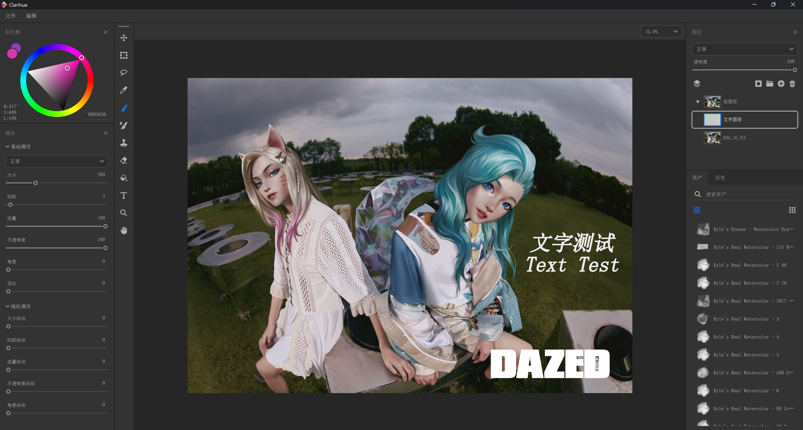
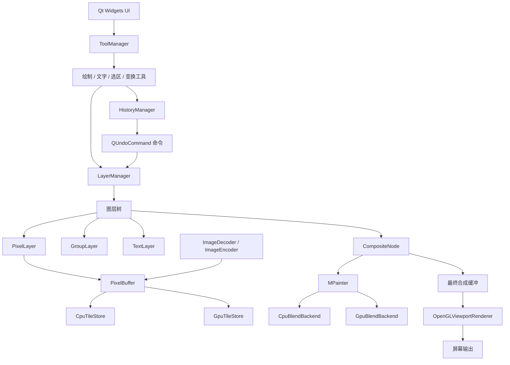

<h1 align="center">Clarihue</h1>

<p align="center">
  基于 C++20、Qt 6 和 OpenGL 的 Windows 图像编辑软件
</p>

<p align="center">
  Windows 10/11 x64 · C++20 · Qt 6 · OpenGL · Portfolio Project
</p>

<h2 align="center">首次使用请在“视图 → 恢复标准布局”</h2>
> 本项目用于个人作品展示和技术面试交流，源代码未公开

## 项目简介

Clarihue 是一款面向桌面端的图像编辑软件，围绕图层化编辑、非破坏式变换预览、文字排版、套索选区和可撤销操作构建

项目重点探索了以下工程问题：

- 如何组织支持多种图层类型的图层树和合成管线
- 如何在保证交互流畅度的同时处理大尺寸、分块存储的图像
- 如何统一 CPU 图像处理、GPU 显示和绘制工具之间的坐标与缓冲模型
- 如何让预览操作、提交操作和撤销重做保持一致
- 如何将 FreeType、HarfBuzz 和 OpenGL 接入 Qt Widgets 应用

## 界面预览



### 可自主编辑的主界面

主界面基于 Qt 的 `QMainWindow` Dock 体系构建，并进行了自定义标题栏和拖拽交互扩展

用户可以自由调整工作区：

- 拖动工具、图层、颜色、属性和历史面板到窗口四周
- 将面板停靠在左侧或右侧
- 将多个面板合并为标签页
- 把面板拖出主窗口形成浮动窗口
- 调整面板宽度、高度和显示顺序
- 关闭后自动保存窗口几何、Dock 状态和浮动面板位置
- 新用户首次启动时使用内置默认布局

不同工作流可以组合出适合自己的界面，例如：

- 绘画布局：工具和笔刷参数靠左，颜色与图层靠右
- 文字排版布局：文字属性面板优先显示
- 调试布局：历史记录和图层面板并排显示

### 基于 QPainter 与 Delegate 的自绘控件

界面没有完全依赖系统默认控件外观，而是通过 `QPainter`、`QStyledItemDelegate` 和自定义事件处理实现了统一的深色视觉体系

自绘控件覆盖：

- 自定义按钮、展开按钮和颜色按钮
- 自定义滑动条、输入框和下拉框
- 自定义菜单、菜单栏和 Dock 标题栏
- 自定义滚动条和悬浮淡入淡出动画
- 自定义树形图层列表和资产列表

列表和树形控件通过 `QStyledItemDelegate` 完成：

- 图标、缩略图、文字和状态图标的精确布局
- 悬停、选中、禁用和缩略图状态绘制
- 图层缩略图、链接状态和可见性图标绘制
- 行高、缩进、编辑器和点击区域的统一定义

自绘方案的优势：

- 控件样式和交互逻辑集中，避免大量重复的 QSS
- 可以精确控制布局、间距、圆角、透明度和动画效果
- 更容易实现与图像编辑器一致的深色工作流
- 为后续主题切换和不同显示缩放比例保留扩展空间
## 下载

Windows 安装包位于本仓库根目录

[下载 Windows 安装包](Clarihue-1.0.0-win64.exe)

## 主要功能

### 图层系统

- 像素图层、组图层和文字图层
- 图层可见性、不透明度、混合模式和上下层移动
- 图层组和递归合成
- 缩略图实时刷新

### 绘制工具

- 普通画笔、橡皮擦和混合器画笔
- 仿制图章和填充工具
- 笔刷尺寸、间距、流量、不透明度、角度和羽化参数
- 支持数位板压力输入
- `.cbrush` 笔刷预设加载

### 文字系统

- 基于 FreeType 和 HarfBuzz 的文字整形与栅格化
- 多行文字布局、光标、文字选区和命中测试
- 字体、字号、颜色、粗体、斜体、下划线和上下标
- 大小写转换
- 文字图层的移动与变换

### 选区与变换

- 自由索套选区
- 按 `Ctrl+D` 取消蚂蚁线，并提交当前临时选区
- 奇偶规则的抗锯齿选区遮罩
- 选区临时图层
- 选区移动、变换和合并
- 像素图层与文字图层的变换预览
- 变换提交、取消以及撤销重做

### 编辑与历史

- 统一的历史管理接口
- 画笔、填充、移动、变换、图层删除、选区创建和合并等操作可撤销
- 工具内部临时历史与文档全局历史协同
- Ctrl+Z 撤销、Ctrl+Shift+Z 重做

### 图像与显示

- PNG、JPEG、TIFF、EXR 等格式的导入
- PNG、JPEG 和 TIFF 导出
- 8 位与 16 位像素数据处理
- OpenGL 视口显示、脏区纹理上传和缩放
- 鼠标中键拖动画布

## 技术栈

| 模块 | 技术 |
|---|---|
| 编程语言 | C++20 |
| 桌面 UI | Qt 6 Widgets |
| 图形显示 | OpenGL / GLSL |
| 图像合成 | CPU Tile 合成、SIMD / AVX2 |
| 图像编解码 | OpenImageIO |
| 文字排版 | FreeType、HarfBuzz |
| Unicode 与国际化 | ICU |
| 构建系统 | CMake、Ninja、vcpkg |
| 安装包 | CPack、NSIS |

## 系统架构



## 关键设计

### 1. Tile 化像素缓冲

图像不要求整幅连续存储，而是通过 Tile 按需分配和访问

这样做的好处：

- 大尺寸画布不需要一开始分配完整内存
- 图层移动或局部绘制时只需要访问相关 Tile
- 脏区合成和 OpenGL 增量上传更容易实现
- 后续可以扩展为更细粒度的缓存和换页策略

### 2. 预览与提交分离

画笔、变换和文字编辑都采用先预览、后提交的流程

```text
输入事件 -> 更新预览缓冲 -> 局部刷新 -> 松手/确认 -> 提交真实数据 -> 写入历史命令
```

这种设计避免每个输入事件都直接修改最终像素，也方便取消操作和实现撤销重做

### 3. 图层树与递归合成

所有图层类型继承统一的 `Node`，组图层可以继续包含子节点

合成阶段从根节点递归遍历，组图层维护自己的离屏合成缓冲，最终统一写入根组缓冲

### 4. 文字布局与字形映射

文字处理链路为：

```text
TextData -> HarfBuzz 字形整形 -> 字形位置与 Cluster -> FreeType 位图 -> TextLayer 投影
```

Cluster 用于把整形后的字形映射回原始 UTF-16 文本偏移，从而支持光标定位、选区和样式修改

### 5. 临时选区图层

套索选区不会直接修改最终图层，而是创建参与合成但不显示在图层面板中的临时图层

选区支持：

- 独立移动和变换
- 与原始图层重新合并
- 创建、移动、变换和合并的历史记录
- 中键平移画布时保持正确的文档坐标

### 6. 历史命令模型

历史系统以 `QUndoCommand` 为统一接口，不同工具根据自身状态选择不同策略：

- 画笔和填充：保存受影响 Tile 的快照
- 移动：保存移动前后的偏移
- 变换：保存变换前后缓冲
- 图层删除：命令持有被删除节点的所有权
- 选区创建与合并：同时维护像素、临时图层和索套状态

## 性能优化

### 局部脏区刷新

绘制和合成以脏区为单位处理，避免每次输入都重新计算整幅画布

### Tile 级并行

部分 Tile 合成和图像处理任务可以并行执行，减少大图层操作的耗时

### SIMD 像素处理

核心混合操作使用 AVX2 批量处理像素，减少逐像素循环开销

### OpenGL 增量上传

CPU 合成结果通过脏区上传到纹理，避免每帧上传完整画布

### 路径与索套渲染

矢量控制柄和索套虚线使用独立的 OpenGL 渲染路径，避免高频重绘时反复走 CPU 路径

### 预览缓存

画笔、文字和变换操作只更新当前交互需要重算的区域，未变化区域复用已有结果

> 性能数据需要在实际发布设备上通过统一 Benchmark 补充，面试时可结合具体画布尺寸、图层数量和笔刷直径说明测试结果

## 工程难点

- 混合位深与通道布局的统一处理
- Tile 坐标系、图层坐标系和画布坐标系之间的转换
- 文字整形结果与原始文本偏移之间的映射
- 缩放、旋转和变换预览中的抖动控制
- 临时图层、历史命令和文档状态之间的一致性
- Qt Widgets 与原生 OpenGL 视口的集成

## 已知限制

- 当前仅支持 Windows x64
- 安装包未使用正式代码签名证书
- ABR 笔刷仅映射了部分参数，复杂动态笔刷尚未完整支持
- 尚未实现完整文档工程文件的保存与恢复
- 暂未覆盖专业印刷级色彩管理流程
- 暂不支持多人协作和云同步

## 后续计划

- 工程文件保存与恢复
- 更完整的 ABR 动态参数和纹理笔刷
- 动画帧与时间轴
- 更完整的颜色管理
- 更完善的自动化测试和性能基准

## 版权说明

Copyright (c) 2026. All Rights Reserved

本项目用于作品展示、技术交流和技术面试，源代码及原创素材未经授权不得复制、修改或再分发

项目使用的第三方库、字体和素材版权归各自权利人所有，并遵循对应许可证
